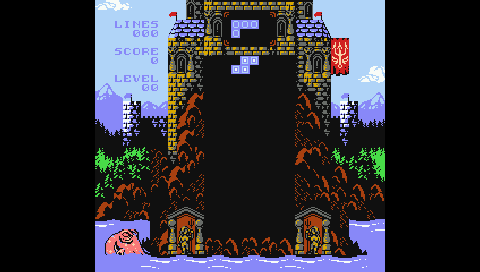
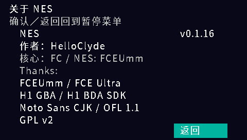

# NES

作者：**HelloClyde**。面向步步高 **H1 / Y100 V1.41** 的独立 FC / NES 原生 BDA 模拟器，版本 **0.1.16**。

当前版本默认使用优化 C 执行路径，保留原有事件调度、PPU/APU 优化和已验证的三国志2 HLE。
所有 ROM 均不启用原生代码分发；不满足已验证优化条件的 Mapper 继续原有保守回退。
这是执行策略调整，不是移除 `prepare_jit` 生成的优化核心。默认构建仍保留符合条件游戏的
原有约 9.41 MiB 缓存分配，以维持已验证的生命周期和事件准入条件。

原生 JIT 仅供显式 `--native-jit` 实验构建使用：加入通用纯 `EA`（NOP）块拒编、
缓存周转退避和分散探测。退避只检测编译抖动，不能保证原生执行比 C 更快；
一次探测也没有硬实时上限。旧 `--jit` 参数仅作为兼容选项，不再开启原生执行。
本轮没有新增按游戏选择执行后端的特判，也未改变菜单或配置格式。
相对上次公开版 v0.1.2 的累计变化、性能依据和验证边界见 [v0.1.16 发布说明](docs/release-v0.1.16.md)。
本文末尾保留旧版优化记录，其中的模拟指令量不能当作当前默认后端的真机测量。

首次运行和显示菜单“恢复默认”使用 **跳帧 1**，即每两帧显示一帧；CPU、APU 和游戏逻辑仍逐帧运行。
已有游戏配置中的跳帧选择会保留，可在显示设置中选择 0 / 1 / 2。

## 快速开始

从 [GitHub Releases](https://github.com/HelloClyde/BBKH1-FC/releases) 下载已发布的安装包，或按下方构建命令生成
`dist/H1FC-install.zip`（默认构建和打包）。将 ZIP 中的 `应用`、`FC` 两个文件夹合并到 H1 的 A 盘：

```text
A:\应用\程序\H1FC.bda
A:\FC\H1FC-TEST.nes
```

菜单标题为 **NES**，图标为红白手柄。启动后选择附带的原创 `H1FC-TEST.nes`
即可检查画面、按键和声音。安装包不含商业游戏 ROM；请自行提供有权使用的 `.nes` 文件，放入 `A:\FC\` 或其他目录后选择打开。
没有选择 ROM 时按退出键会返回桌面。游戏中按 P 或触摸画面打开暂停菜单，
点底部“关于”查看作者和版本；退出模拟器请在暂停菜单选择“退出游戏”。
支持浏览其他目录及 GBK 中文文件名；无需 BIOS 或 ROM 清单。

旧版的 `H1FC-JIT.bda` 可在升级后移除，避免重复图标；原游戏、存档与配置路径不变。
已发布版本的历史文件名可能不同，按其包内说明安装。

本版针对 H1 V1.41 接口开发，沿用预发布性质。最终发布 BDA 的身份与验证范围见
[发布证据](docs/evidence/release-v0.1.16.json)。开发期间做过真机短场景对照，
但使用的是旧前端加 RAM 中的新核心，不能冒充最终 BDA 的整包真机验证，也不代表所有游戏或通关兼容性。

## 截图

以下为本项目在完整 H1 V1.41 / QEMU `bbkh1` 中的真实帧缓冲，非真机截图。
游戏为作者发布的 From Below 1.0（Classic 模式），安装包不含该 ROM。
以下截图来自最终 v0.1.16 默认 BDA 的完整固件功能验证；模拟器截图不用于证明真机帧率。

| 原生桌面图标 | 游戏实玩 |
| --- | --- |
|  |  |

| 暂停菜单 | 作者与版本 |
| --- | --- |
|  |  |

## 功能

- iNES / NES 2.0 卡带加载，完整编译上游 mapper 集合；实际兼容性取决于 FCEUmm
  及 H1 可用内存。只在选择器中接收 `.nes`，不接收 ZIP、FDS、NSF 或 UNIF。
  本版限制 PRG/CHR 合计约 4 MiB，NES 2.0 声明 RAM 合计不超过 2 MiB。
- 6502 CPU、PPU、APU，按 ROM/核心识别 NTSC 或 PAL 时序。
- 256×240 画面，原始大小、像素等比放大（290×272）、全屏拉伸和线性平滑四种模式。
- 核心 22050 Hz 混音、H1 32000 Hz 16 位单声道 PCM，声音开关和 0–100% 音量设置；退出恢复系统音量。
- 单人标准手柄、组合按键和按键重映射。新配置默认跳帧 1，可选择 0／1／2；
  开启声音时，待播量低于 80 ms 会临时跳 2 帧，近期重复欠载时可跳至 5 帧。
  缓冲恢复后回到用户设置；旧欠载会从近期统计中过期，避免长时间保留过高跳帧。
  CPU、APU 与游戏逻辑始终逐帧运行，声音优先时显示帧率会降低。
  自动存档前暂时积累更多待播音频，减少写盘导致的断音。
  欠载恢复保留播放描述符，插入约 16 ms 静音余量并在 4 ms 内淡入，持续算力不足时仍可能断音。
- 触摸／实体键中文暂停菜单，暂停时停止核心与声音，支持换游戏和正常退出。
- 电池存档、三槽即时存取档和每个 ROM 独立的显示／按键／音量配置。
  电池 RAM 的多个区段聚合保存；无电池卡带不生成电池存档。

| H1 实体键 | 功能 |
| --- | --- |
| 方向键 | 十字键 |
| Z／确认 | A |
| X／Escape／返回 | B（游戏内） |
| Enter | Start |
| 空格 | Select |
| P／触摸游戏画面 | 暂停设置 |
| V | 切换显示模式 |
| F | 跳帧 0／1／2 |
| M | 保存并更换游戏 |

暂停菜单内 Escape／返回用于返回或继续游戏；按键映射等待绑定时，它们可设为游戏键，P 用于取消绑定。

## 存档

电池存档位于 ROM 旁边，例如 `game.nes.s0`、`game.nes.s1`，每 10 秒检查一次变化，
正常换游戏／退出时再检查。即时存档为 `.st1.s0/.s1` 至 `.st3.s0/.s1`；
配置为 `.cfg.s0/.s1`。这些文件带有校验头，不是其他模拟器的裸 `.sav` 格式。

采用双槽、序号、头部／数据 CRC 和写后读回校验，以**完整 ROM CRC**识别卡带。
最新槽损坏时回退至另一个有效槽；两槽损坏或卡带身份不符时保留原文件并禁用本次保存。
请同时备份两个槽。断电仍可能丢失最近一次成功检查之后的进度。

同长度的备用槽优先原位更新，继续完整写入、关闭、重新打开并校验，不改变存档格式或检查间隔。
对内容严格匹配的三国志2中文版，周期变化判断排除已验证的 12 个音乐寄存器字节，
避免音乐播放反复触发写盘；实际提交仍保存全部数据。其他 ROM 使用原有完整变化检查。
同步保存仍可能短暂停顿，尚未改成后台写盘。

诊断日志为 `A:\FC\h1fc.log`；每次启动覆盖，排错时请先备份。

## 依赖

使用成品只需要 H1 / Y100 V1.41 和自己的 NES 游戏，无需 BIOS、PC 运行库或开发工具。
字体及图标已嵌入 BDA，不需要额外安装字体。

| 开发依赖 | 固定版本／用途 |
| --- | --- |
| [H1 BDA SDK](https://github.com/MrDefinition1999/bbk-h1-bda-sdk) | `sdk/`，`067fe072477861dfc8949d7b1a55279fb92d2548`；接口、图标与 BDA 打包 |
| [FCEUmm](https://github.com/libretro/libretro-fceumm) | `third_party/fceumm/`，`ac0d00a7fc01166f84c7bac01d1084ebfd2b865e`；模拟核心 |
| GNU MIPS 工具链 | GCC 15.2.0，固定下载 SHA-256；Windows 安装器见 `tools/install_toolchain.py` |
| Python / Git | Python 3.10+，CI 为 Python 3.12 / Windows；Git 用于子模块与发布打包 |
| Pillow / Unicorn | 12.3.0 / 2.1.4，锁定于 `requirements.txt`；图标生成与 MIPS 自动测试 |
| Noto Sans CJK SC | OFL 1.1；预生成字形随源码提供，普通构建不下载字体 |

## 构建

在独立仓库根目录执行：

```powershell
git clone https://github.com/HelloClyde/BBKH1-FC.git
cd BBKH1-FC
git submodule update --init
python -m pip install -r requirements.txt
python tools/install_toolchain.py
python tools/build.py
python tools/package.py
```

默认寻找 `.tools/toolchain/bin`，也可使用 `H1_GNU_BIN` 或 `--toolchain` 指定
`mipsel-none-elf-gcc/g++/objcopy`。成品位于 `dist/`。
仅在需要原生 JIT 实验时使用 `python tools/build.py --native-jit`，随后
`python tools/package.py --jit` 生成独立实验安装包。常规构建不加这两个参数。
`--build-dir <目录>` 隔离候选输出并自动启用 `--no-dist`，不会替换 `dist/`；
实验缓存容量可用 `--jit-cache-mib` 设置，此项也适用于默认 C 保留的缓存。
完整 Release 源码 ZIP 包含两个固定子模块的源码和 `source-manifest.json`；
解压后可从安装 Python 依赖开始构建，无需再次获取 Git 子模块。

构建检查依赖版本与工作树，补丁只应用于各构建目录的 `fceumm-h1/`，避免并行变体互相覆盖。
链接器检查入口 `0x83c00020` 及本程序静态代码、数据和栈的地址范围；这不是 H1 总内存或堆分配上限。
大块备用颜色表按需从系统堆申请。构建生成 ELF、BDA、SHA-256 和元数据。
`--verbose-log` 生成独立诊断包；`--test-frames 20` 生成有界测试包，保存在 `build/`
而不覆盖正式产物。`--benchmark` 仅允许搭配有界测试，关闭声音和限速。

## 验证

```powershell
python tests/run_platform_tests.py
python tools/build.py --test-frames 20
python tests/mips_smoke.py
python tests/mips_smoke.py --bda dist/H1FC.bda --menu --quick
python tests/pause_menu_smoke.py
python tests/audio_smoke.py
python tests/options_smoke.py
python tests/check_icon.py --zip dist/H1FC-install.zip
```

平台回归覆盖 FC 分辨率缩放、原生组合键、选择器／GBK 路径、增量 CRC、双槽恢复、
写入失败、损坏保护以及 ROM 后半部分变化后的身份拒绝。
测试 ROM 由 `tests/make_test_rom.py` 生成，是原创 6502 程序，不含商业游戏。
各次运行的详细证据保存在 `build/verification/`；基础验证见
[0.1.0 记录](docs/verification.md)，图标修复与完整游戏测试见
[0.1.1 记录](docs/verification-0.1.1.md)。
0.1.2 的确切发布 BDA、关于页面和取消退出验证见 [发布记录](docs/release-v0.1.2.md)。
0.1.3 的音频修复与测试范围见 [音频验证](docs/audio-v0.1.3.md)。
0.1.4 的后续优化及设备诊断步骤见 [继续排查](docs/audio-v0.1.4.md)。
0.1.5 的合并输出、准确跳帧和持续播放恢复见 [优化验证](docs/audio-v0.1.5.md)。
完整固件测试需要自行提供固件与 QEMU，不随仓库分发；见 [开发验证说明](docs/development.md)。
CI 执行的是实际 MIPS 代码配合 H1 服务替身，不冒充完整固件或真机验证。

## 历史优化记录

<details>
<summary>展开 v0.1.2 至 v0.1.15 的开发记录</summary>

以下保留当时的后端、文件名和测量结论；其中“当前”均指对应历史版本，
不覆盖 v0.1.16 的默认 C 策略。

0.1.15 为已验证的三国志2中文版加入等待循环 HLE：在原 CPU 时间片和下一硬件事件之前，
直接计算重复等待的结果。只对匹配 ROM 内容校验的版本自动启用，其他 ROM 继续原路径；
这不是所有 Mapper 19 游戏通用的 HLE。JIT 入口统一转交该循环，批处理避免硬件除法。
与 0.1.14 普通版相比，跳帧 1 的 1800 帧完整应用 MIPS 指令量减少 **5.47%**，
城市 300 帧减少 **3.89%**；跳帧 0 分别减少 **4.64% / 3.29%**。
画面、PCM、状态、播放环及存档严格一致。这些数值不是真机加速或全速运行的证明。
同版本《魂斗罗》第一关的 MIPS 指令量反而高于三国志2城市，用户真机体验却更流畅；
后续性能判断需加入实际周期、缓存和访存证据，不能只优化指令数量。
详见 [0.1.15 HLE 记录](docs/optimization-v0115.md)与[魂斗罗对照](docs/contra-mapper2-control.md)。

0.1.14 将条件分支基础周期并入安全批次，减少短片段内的重复调度；
PPU 只在 OAM 写入、状态恢复或观察者边界重新验证精灵索引。
三国志 II 的 1800 帧普通版完整应用对照中，相同跳帧 1 下，MIPS 指令量比
0.1.13 减少 **4.75%**，城市操作段减少 **4.51%**；跳帧 0 下分别减少
**4.06% / 3.83%**，画面、PCM、状态、播放环和存档严格一致。
这些是模拟执行指令量，不是真机帧率；JIT 总调用次数基本不变，本轮降低每段执行成本。
较长编译轨迹与 PPU 行合成融合实验因收益不足未合入。
设计、动态压力测试和完整验证见[0.1.14 优化记录](docs/optimization-v0114.md)。
诊断构建在重启验证中出现计时器回卷校验失败，本次仅提供普通安装包；
普通版和上述指令量对照不受影响。

0.1.13 优化 JIT 子程序/栈操作与控制流末尾的安全预算批次，并批量合成精灵、
复用稳定 OAM 的行索引。三国志 II 的 1800 帧普通版完整应用对照中，相同跳帧 1 下，
MIPS 指令量比 0.1.12 减少 **1.98%**，城市操作段减少 **2.68%**；
跳帧 0 下分别减少 **2.21% / 3.13%**，画面、PCM、状态、播放环和存档严格一致。
PPU 静态内存增加约 2.14 KiB，JIT 堆分配规模不变；频繁改变 OAM 时使用线性回退。
这些是模拟执行指令量，不是真机帧率或断音改善幅度。
选型、动态场景限制和完整验证见[0.1.13 优化记录](docs/optimization-v0113.md)。

0.1.12 优化对齐内存复制与比较，并让只够执行一条指令的短预算调用走现有 C 路径，
减少 JIT 进出成本。三国志 II 的 1800 帧完整应用对照中，相同跳帧 1 设置下，
MIPS 指令量比 0.1.11 减少 **1.53%**，城市阶段减少 **1.52%**；
相同跳帧 0 下分别减少 **2.28% / 2.28%**。画面、PCM、状态和存档严格一致。
本轮没有新增数据缓存或移动 PPU 同步边界；快速 JIT 分发实验因城市阶段退步未合入。
这些数据不是物理 H1 的帧率或音频欠载测量，见[0.1.12 优化记录](docs/optimization-v0112.md)。

0.1.11 优化 PPU 对齐背景展开，并复用内容未变的最近邻缩放行，额外数据内存约 **0.57 MiB**。
三国志 II 的 1800 帧完整应用对照中，相同跳帧 1 设置下，MIPS 指令量比
0.1.10 减少 **7.58%**，城市命令阶段减少 **7.55%**，画面、PCM、状态和存档一致。
相同跳帧 0 设置下，完整流程与城市阶段分别减少 **12.07% / 12.13%**。
这是真实 MIPS 程序的模拟执行成本，不是真机帧率；动态画面与特殊 Mapper 不保证同等收益。
JIT 覆盖扩展试验因整段收益不足 0.2% 未合入，现有 JIT 缓存大小不变。
设计、完整应用对照和适用范围见[0.1.11 优化记录](docs/optimization-v0111.md)。

0.1.10 优化完整指令区间的预算检查、版本化块入口、正常显示帧的 PPU 背景处理，
以及方波、三角波、噪声和 DMC DAC 的区间合成，并合并 Mapper/APU 事件期限判断。
三国志 II 的 1800 帧完整应用对照中，相同跳帧 0 / 1 设置下，MIPS 指令量分别比
0.1.9 减少 **5.91% / 4.48%**；城市命令阶段分别减少 **5.30% / 3.64%**，画面、PCM 和存档一致。
这些是模拟执行成本，不是真机帧率；C 回退仍保留逐指令的廉价期限检查。
代码缓存扩为 **8 MiB**，
入口表、bank 索引和验证凭据另占约 1.41 MiB，JIT 堆内存合计约 **9.41 MiB**。
设计、同设置下的完整应用对照及验证边界见[0.1.10 优化记录](docs/optimization-v0110.md)。

0.1.9 在切换 ROM bank 后复用已有编译块，保留 CPU 地址、映射和代码内容检查。
默认 JIT 代码缓存改为 **4 MiB**，加上 1 MiB 入口表及 162 KiB bank 索引，
JIT 堆内存合计约 **5.16 MiB**；分配失败时使用解释器。
三国志 II 的 1800 帧完整应用对照中，指令量比 0.1.8 默认 1 MiB 减少 **1.19%**，
进入城市及命令阶段减少 **2.32%**，输出严格一致；这是模拟执行成本，不是真机帧率。
完整应用的 1 MiB / 4 MiB 对比及正确性验证见[bank 缓存优化记录](docs/optimization-v019.md)。

0.1.8 聚合跳帧时没有观察者的背景读取，保留 PPU 完整移位寄存器、滚动、精灵和 Mapper 时序；
JIT 在已证明无事件的指令段中合并 PC/PI 写回。存档先检查变化，实际写入前暂停播放环，
写完后重新预充并淡入，保留双槽与完整回读验证。同步 IO 期间仍会停顿和静音。
诊断版改为每 31 帧采样一次 PPU 细分计时，避免逐背景调用计时显著拖慢运行；
采样 PPU 耗时不再当作整段 PPU 开销。说明及实测范围见[本轮优化记录](docs/optimization-v018.md)。

0.1.7 将游戏中的 Escape／返回键交给游戏，默认映射为 **B**，不再直接退出模拟器。
用 P／触摸画面打开暂停菜单，选择“退出游戏”才保存并退出。
旧配置自动补上 B 键映射并保留其他设置；未选择 ROM 时仍可取消并返回桌面。
见[退出键与配置迁移验证](docs/evidence/exit-key-v0.1.7.json)。

0.1.6 为已确认纯内存操作的连续指令建立无事件运行区间，允许在 CPU 预算边界提前结束并准确提交时钟；
同时优化原始大小、保持比例和全屏拉伸的 indexed 显示路径，减少重复像素取色。
桌面和关于页名称缩短为 **NES**，避免桌面标签显示不全。安装文件仍为 `H1NES.bda`。
本轮设计和实际验证见[优化记录](docs/optimization-v4.md)，名称调整见[校验记录](docs/evidence/name-shortening.json)。
三国志 II 的完整应用模拟测试中，600 帧有声标题和 1800 帧新游戏/城市操作的指令量
分别比 0.1.5 减少 **11.10% / 10.70%**，画面、PCM 和存档一致；这不是物理 H1 的帧率测量。

0.1.5 将 FC 调色板转换与四种显示缩放合并，减少 RGB565 中间图读写；跳帧时省略
不影响碰撞判断的像素合成，保留 CPU/APU、Mapper 和精灵标志。音频欠载时继续使用
原播放环，以短静音余量和淡入恢复，避免每次清空后重新预填。实际设备效果仍待复测。
桌面名称为 **NES**（FC / NES 模拟器），安装文件为 `H1NES.bda`。
当前安装包对 NROM / Mapper 19 启用原生块、热块直连、A/P 寄存器驻留及 APU/IRQ 无事件内联路径，
其他情况回退解释器。后端名称只用于开发和诊断。见[整体设计](docs/jit-design.md)
及[v3 历史验证记录](docs/jit-experimental.md)。模拟测试的收益不等于真机帧率。

0.1.4 根据用户的持续欠载日志继续优化背景调色板缓存、ROM 读取热路径与跳帧输出，
核心以 22050 Hz 混音、重采样到 H1 的 32000 Hz 输出；反复欠载时可临时降至每六帧
显示一帧。新增核心内部耗时诊断。用户设备上的效果尚待复测，模拟器结果不代表真机速度。
0.1.3 优化 mapper 19 / N163 扩展音源混音和 32 kHz PCM 输出，并在缓冲偏低时
临时跳过部分画面输出以优先补充声音；CPU/APU 始终运行，不修改用户保存的跳帧设置。
混音优化经固定上游算法逐样本对比；真机改善程度仍需实测。
0.1.2 在“关于”页加入作者，使用可再分发的 Noto 菜单字体，并提供独立源码与 CI 构建。
保留 0.1.1 的透明桌面图标、取消选择返回桌面及菜单确认键防穿透修复。
核心采用固定版本的 [FCEUmm](https://github.com/libretro/libretro-fceumm)，
H1 显示、输入、PCM、菜单和存档接口沿用已建立的平台层。

</details>

## 感谢

- [H1 GBA / HelloClyde](https://github.com/HelloClyde/BBKH1-GBA)：原生显示、输入、PCM 和存档平台基础。
- FCEUmm / FCE Ultra 开发者与 libretro 社区：FC CPU、PPU、APU 与 mapper 核心。
- [H1 BDA SDK](https://github.com/MrDefinition1999/bbk-h1-bda-sdk) 开发者：H1 服务接口、资源打包和验证工具。
- Adobe / Noto CJK：可再分发的中文菜单字体。
- Matt Hughson、Tui、Haller Zoltan：From Below 测试游戏及音乐、美术；ROM 不随本项目分发。

本版未实现双人控制、光枪、金手指、联机或磁碟换面。
来源、许可和图标生成记录见 [NOTICE.md](NOTICE.md) 与 [图标说明](assets/README.md)。
