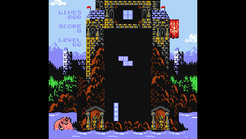
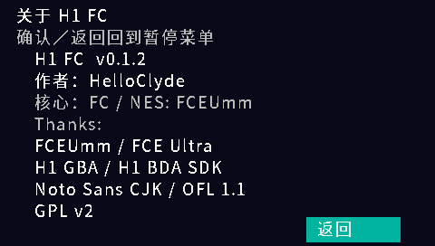

# H1 FC / NES 模拟器

作者：**HelloClyde**。面向步步高 **H1 / Y100 V1.41** 的独立 FC / NES 原生 BDA 模拟器，版本 **0.1.2**。

0.1.2 在“关于”页加入作者，使用可再分发的 Noto 菜单字体，并提供独立源码与 CI 构建。
保留 0.1.1 的透明桌面图标、取消选择返回桌面及菜单确认键防穿透修复。
核心采用固定版本的 [FCEUmm](https://github.com/libretro/libretro-fceumm)，
H1 显示、输入、PCM、菜单和存档接口沿用已建立的平台层。

## 快速开始

从 [GitHub Releases](https://github.com/HelloClyde/BBKH1-FC/releases) 下载 `BBKH1-FC-v0.1.2-install.zip`，或按下方构建命令生成
`dist/H1FC-install.zip`。将 ZIP 中的 `应用`、`FC` 两个文件夹合并到 H1 的 A 盘：

```text
A:\应用\程序\H1FC.bda
A:\FC\H1FC-TEST.nes
```

菜单标题为 **H1 FC**，图标为红白手柄。启动后选择附带的原创 `H1FC-TEST.nes`
即可检查画面、按键和声音；将自己的 `.nes` 游戏放入 `A:\FC\` 或其他目录后选择打开。
没有选择 ROM 时按退出键会返回桌面。游戏中按 P 打开暂停菜单，点底部“关于”查看作者和版本。
支持浏览其他目录及 GBK 中文文件名；无需 BIOS 或 ROM 清单。

本版针对 H1 V1.41 接口开发，已通过实际 MIPS BDA 自动化测试，并在完整 V1.41
固件模拟器中从原生选择器启动游戏。真机速度、长时间稳定性及商业游戏兼容性仍需实测。
首次公开版本作为预发布提供。

## 截图

以下为本项目在完整 H1 V1.41 / QEMU `bbkh1` 中的真实帧缓冲，非真机截图。
游戏为作者发布的 From Below 1.0（Classic 模式），安装包不含该 ROM。

| 原生桌面图标 | 游戏实玩 |
| --- | --- |
|  |  |

| 暂停菜单 | 作者与版本 |
| --- | --- |
|  |  |

## 功能

- iNES / NES 2.0 卡带加载，完整编译上游 mapper 集合；实际兼容性取决于 FCEUmm
  及 H1 可用内存。只在选择器中接收 `.nes`，不接收 ZIP、FDS、NSF 或 UNIF。
  本版限制 PRG/CHR 合计约 4 MiB，NES 2.0 声明 RAM 合计不超过 2 MiB。
- 6502 CPU、PPU、APU，按 ROM/核心识别 NTSC 或 PAL 时序。
- 256×240 画面，原始大小、像素等比放大（290×272）、全屏拉伸和线性平滑四种模式。
- H1 32000 Hz、16 位单声道 PCM，声音开关和 0–100% 音量设置；退出恢复系统音量。
- 单人标准手柄、组合按键和按键重映射。默认不跳帧，可选择跳 1／2 帧。
- 触摸／实体键中文暂停菜单，暂停时停止核心与声音，支持换游戏和正常退出。
- 电池存档、三槽即时存取档和每个 ROM 独立的显示／按键／音量配置。
  电池 RAM 的多个区段聚合保存；无电池卡带不生成电池存档。

| H1 实体键 | 功能 |
| --- | --- |
| 方向键 | 十字键 |
| Z／确认 | A |
| X | B |
| Enter | Start |
| 空格 | Select |
| P／触摸游戏画面 | 暂停设置 |
| V | 切换显示模式 |
| F | 跳帧 0／1／2 |
| M | 保存并更换游戏 |
| Escape／返回 | 保存并退出 |

## 存档

电池存档位于 ROM 旁边，例如 `game.nes.s0`、`game.nes.s1`，每 10 秒检查一次变化，
正常换游戏／退出时再检查。即时存档为 `.st1.s0/.s1` 至 `.st3.s0/.s1`；
配置为 `.cfg.s0/.s1`。这些文件带有校验头，不是其他模拟器的裸 `.sav` 格式。

采用双槽、序号、头部／数据 CRC 和写后读回校验，以**完整 ROM CRC**识别卡带。
最新槽损坏时回退至另一个有效槽；两槽损坏或卡带身份不符时保留原文件并禁用本次保存。
请同时备份两个槽。断电仍可能丢失最近一次成功检查之后的进度。

诊断日志为 `A:\FC\h1fc.log`；每次启动覆盖，排错时请先备份。

## 依赖

使用成品只需要 H1 / Y100 V1.41 和自己的 NES 游戏，无需 BIOS、PC 运行库或开发工具。
字体及图标已嵌入 BDA，不需要额外安装字体。

| 开发依赖 | 固定版本／用途 |
| --- | --- |
| [H1 BDA SDK](https://github.com/MrDefinition1999/bbk-h1-bda-sdk) | `sdk/`，`067fe072477861dfc8949d7b1a55279fb92d2548`；接口、图标与 BDA 打包 |
| [FCEUmm](https://github.com/libretro/libretro-fceumm) | `third_party/fceumm/`，`ac0d00a7fc01166f84c7bac01d1084ebfd2b865e`；模拟核心 |
| GNU MIPS 工具链 | GCC 15.2.0，固定下载 SHA-256；Windows 安装器见 `tools/install_toolchain.py` |
| Python / Git | Python 3.10+，CI 为 Python 3.12 / Windows；Git 用于子模块与发布打包 |
| Pillow / Unicorn | 12.3.0 / 2.1.4，锁定于 `requirements.txt`；图标生成与 MIPS 自动测试 |
| Noto Sans CJK SC | OFL 1.1；预生成字形随源码提供，普通构建不下载字体 |

## 构建

在独立仓库根目录执行：

```powershell
git clone https://github.com/HelloClyde/BBKH1-FC.git
cd BBKH1-FC
git submodule update --init
python -m pip install -r requirements.txt
python tools/install_toolchain.py
python tools/build.py
python tools/package.py
```

默认寻找 `.tools/toolchain/bin`，也可使用 `H1_GNU_BIN` 或 `--toolchain` 指定
`mipsel-none-elf-gcc/g++/objcopy`。成品位于 `dist/`。
完整 Release 源码 ZIP 包含两个固定子模块的源码和 `source-manifest.json`；
解压后可从安装 Python 依赖开始构建，无需再次获取 Git 子模块。

构建检查依赖版本与工作树，补丁只应用于 `build/fceumm-h1/`。
链接器检查入口 `0x83c00020` 及 4 MiB 加载窗口，生成 ELF、BDA、SHA-256 和元数据。
`--verbose-log` 生成独立诊断包；`--test-frames 20` 生成有界测试包，保存在 `build/`
而不覆盖正式产物。`--benchmark` 仅允许搭配有界测试，关闭声音和限速。

## 验证

```powershell
python tests/run_platform_tests.py
python tools/build.py --test-frames 20
python tests/mips_smoke.py
python tests/mips_smoke.py --bda dist/H1FC.bda --menu --quick
python tests/pause_menu_smoke.py
python tests/options_smoke.py
python tests/check_icon.py --zip dist/H1FC-install.zip
```

平台回归覆盖 FC 分辨率缩放、原生组合键、选择器／GBK 路径、增量 CRC、双槽恢复、
写入失败、损坏保护以及 ROM 后半部分变化后的身份拒绝。
测试 ROM 由 `tests/make_test_rom.py` 生成，是原创 6502 程序，不含商业游戏。
各次运行的详细证据保存在 `build/verification/`；基础验证见
[0.1.0 记录](docs/verification.md)，图标修复与完整游戏测试见
[0.1.1 记录](docs/verification-0.1.1.md)。
0.1.2 的确切发布 BDA、关于页面和取消退出验证见 [发布记录](docs/release-v0.1.2.md)。
完整固件测试需要自行提供固件与 QEMU，不随仓库分发；见 [开发验证说明](docs/development.md)。
CI 执行的是实际 MIPS 代码配合 H1 服务替身，不冒充完整固件或真机验证。

## 感谢

- [H1 GBA / HelloClyde](https://github.com/HelloClyde/BBKH1-GBA)：原生显示、输入、PCM 和存档平台基础。
- FCEUmm / FCE Ultra 开发者与 libretro 社区：FC CPU、PPU、APU 与 mapper 核心。
- [H1 BDA SDK](https://github.com/MrDefinition1999/bbk-h1-bda-sdk) 开发者：H1 服务接口、资源打包和验证工具。
- Adobe / Noto CJK：可再分发的中文菜单字体。
- Matt Hughson、Tui、Haller Zoltan：From Below 测试游戏及音乐、美术；ROM 不随本项目分发。

本版未实现双人控制、光枪、金手指、联机或磁碟换面。
来源、许可和图标生成记录见 [NOTICE.md](NOTICE.md) 与 [图标说明](assets/README.md)。
