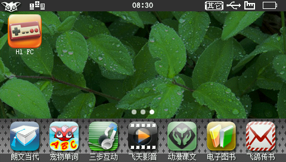
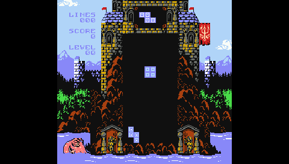

# H1 FC v0.1.1 验证记录

本页保留历史工作区的命令与构建身份。当前独立仓库的构建入口见 [README](../README.md)
和 [开发验证说明](development.md)，请勿用旧版哈希校验新版本。

日期：2026-10-13。核心与 SDK 沿用 0.1.0；本版更换图标，并修复菜单返回时的按键穿透。
正式 BDA 953,352 字节，SHA-256：

`5ce6893eac746c86e4ffbfd5c7bc243d6dbc71699fa8cc9526e0e045efb25d58`

## 图标

旧图标为 RGB PNG，圆角外部的近黑色像素没有透明通道；旧 BDA 的桌面资源四角
alpha 均为 255。问题来自图片本身。

使用 imagegen 编辑为 RGBA PNG，保留橙色圆角底板及手柄，清除外部背景。
新源图为 1254×1254，四角 alpha 均为 0，包含 48,519 个全透明像素。
实际 BDA 的 45×45 和 57×57 资源四角 alpha 均为 0，分别包含 29／49
个全透明像素，并与当前源图经 SDK 编码后的字节严格一致。
资源 2／3 是固件既定的无 alpha RGB565 格式。

见 [源图与 BDA 逐资源审计](evidence/v0.1.1-icon.json) 和
[生成／编辑提示词](../assets/README.md)。

## 正式 BDA 回归

- [MIPS 快速回归](evidence/v0.1.1-menu-smoke.json)：画面比例、A 按下／释放、
  8,192 个 APU PCM 样本、带 CRC 的 8 KiB 电池 RAM 跨启动恢复、选择器取消通过。
- [暂停／即时存档](evidence/v0.1.1-pause-menu-smoke.json)：暂停 CPU/RAM 静止、
  三槽各 22,002 字节状态保存、主动破坏 CPU/RAM 后恢复、坏槽／空槽保护和 PCM
  设备复用通过。均执行本页 SHA 对应的正式 BDA。

这些测试使用真实 MIPS 代码和 H1 服务替身；宿主测试耗时不代表 H1 真机速度。

## 实玩发现并修复的按键问题

H1 的确认键与 Enter 共享原生 scancode 28。暂停菜单消费确认键的 DOWN 事件后，
按键尚未释放，原实现恢复游戏时会将它解释为 Enter/Start。From Below 因而进入
游戏自己的暂停状态，画面变暗，虽然仍有暂停音乐。仅检查 PCM 非静音无法发现此问题。

现在从选择器、菜单或提示框返回时，记录当前仍按住的原生键，直到该键释放才重新
接收；同时清除别名归属。该处理不阻塞等待，释放后的方向键、A 和组合键仍可正常使用。
主机回归覆盖确认／Enter／Z／P 连续持有、释放后重按、触摸返回与方向+A组合。
临时禁用此修复的负向测试会触发新增断言，保留完整实现时全部通过。
完整固件测试还检查恢复后两次落块区域截图确实变化，防止“游戏再次暂停但仍有音乐”
被误判为恢复成功。
主机正向／负向证据见 [返回按键回归](evidence/v0.1.1-menu-return-regression.json)。

## 完整 FC 游戏实玩

使用 Matt Hughson 作者发布的 [From Below 1.0](https://mhughson.itch.io/from-below)，
选择 Classic 落块模式。该游戏是 2020 年的 FC 自制游戏，测试经典俄罗斯方块玩法；
不能据此声称《超级马里奥》《魂斗罗》等商业经典游戏已通过测试。

ROM 来自[作者仓库](https://github.com/mhughson/mbh-firstnes/tree/master/promotion/itch_emulator/roms)，
40,976 字节、mapper 0，SHA-256：

`1a3ac4faf4b35640505344059ae5d91dae07cd47e1fb4d9d2a33c76391f1c555`

ROM 和捕获的音频只留在本机 `build/` 测试目录，不随安装包分发。
使用本机 V1.41 完整固件和 QEMU，在 `build/from-below-v011-fixed/` 创建私有 NAND，
独立端口 8813／8814。画面已进入实际落块区域，截图确认左移、A 旋转及上键快速落底。
桌面截图确认圆角之外显示绿叶壁纸，旧图标的黑底已消除。
同一桌面位置的四角像素 `(13,24)`、`(69,24)`、`(13,80)`、`(69,80)`，
旧截图全部为 `(0,0,0)`，修复后分别为 `(40,96,40)`、`(56,112,40)`、
`(24,64,24)`、`(40,80,24)`；相邻外围像素与旧截图一致。

最终修复版完整运行记录 **1,478 帧、0 个视频错误**，`APP_END result=0`，QEMU 正常退出。
暂停画面连续两张截图完全一致；恢复后画面正常明亮，方块持续下落，两次落块区域截图
不同。暂停前、恢复后分别捕获约 3.02／2.01 秒的 32000 Hz PCM，均有非零音频样本。
应用日志的 dropped／failures／underruns 均为 0；QEMU AIC 会话 underruns 为 632，
是不同层面的计数，不能据此声称真机零卡顿。没有验证消行、通关或 H1 真机性能。

完整数值、来源与图片校验见 [实玩报告](evidence/v0.1.1-from-below.json)、
[ROM 来源](evidence/v0.1.1-from-below-source.json) 和
[应用日志](evidence/v0.1.1-from-below-run.log)。





复现完整固件测试（需要本机已有 H1 固件、QEMU 和作者发布的游戏文件）：

```powershell
python h1-fc/tools/classic_smoke.py --rom h1-fc/build/game-fixtures/from-below/from_below_2020_09_16_v_1_0_0.nes --title "From Below 1.0 (Classic)" --expected-sha 5ce6893eac746c86e4ffbfd5c7bc243d6dbc71699fa8cc9526e0e045efb25d58 --from-below --work-dir h1-fc/build/from-below-repeat
```

每次复现使用一个新目录，脚本保留之前运行的镜像和证据。首次人工测试停留到 Game Over，
结束曲停止，音频断言失败；第二轮揭示上述暂停按键穿透，不能视作恢复通过。
这两次中间结果保留在本机 `build/from-below-v011*`，本节只引用修复后的最终运行。

## 复现图标检查

```powershell
python h1-fc/tools/build.py
python h1-fc/tests/check_icon.py
python h1-fc/tools/package.py
python h1-fc/tests/check_icon.py --zip h1-fc/dist/H1FC-install.zip
```

图标审计同时核对正式构建标志、PNG/BDA/ZIP 内容与构建元数据，避免只替换源图而
交付旧安装包。ZIP 本身的 SHA 不写入 ZIP 内部的报告，避免自引用。
