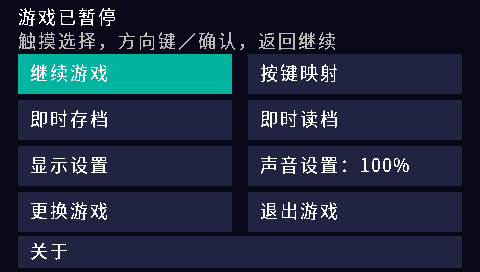

# H1 FC v0.1.0 验证记录

本页保留历史工作区的命令与构建身份。当前独立仓库的构建入口见 [README](../README.md)
和 [开发验证说明](development.md)，请勿用旧版哈希校验新版本。

日期：2026-10-13。核心 FCEUmm `ac0d00a7fc01166f84c7bac01d1084ebfd2b865e`，
H1 SDK `067fe072477861dfc8949d7b1a55279fb92d2548`，GNU MIPS GCC 15.2.0。

## 构建

正式包 **953,016 字节**，SHA-256：

`3c99ca3e1c36804c0e6dc681ffdcff3caaeec58d3ebf780eb3c9519b9b8619cb`

测试 20 帧包 SHA-256：

`1296995c7b374e3b8543e7c1467489c236b86e56a4e04be1aada4d5bf8644714`

全部核心及 mapper 源文件经 MIPS32 little-endian soft-float 编译，平台源码启用
`-Wall -Wextra -Werror`，链接器的入口与加载窗口断言通过，SDK 格式验证通过。
重复构建正式包得到完全相同的字节。测试及 benchmark 构建未覆盖正式包。

## 平台与 MIPS 回归

- 主机平台测试：256×240／256×224 四种缩放、组合键及别名释放、GBK 路径、选择器
  取消／非法输出、分块 CRC、双槽恢复、短写失败、两槽损坏保护、ROM 后部变化身份拒绝。
- [完整 MIPS 套件](evidence/mips-smoke.json)：实际执行测试 BDA，覆盖画面、A 按下／释放、
  APU 方波、8 KiB 电池 RAM 跨启动恢复、中文路径、无电池卡带、存档损坏／身份不符、
  非法文件头、截断 ROM、NES 2.0 超大声明及不支持的 mapper；检查 ABI、文件和堆清理。
- [正式包验证](evidence/menu-smoke.json)：相同正式 BDA 通过画面、按键、PCM、存档恢复
  和选择器取消；以模拟按键退出，未依靠测试包自动终止。
- [正式包暂停菜单](evidence/pause-menu-smoke.json)：暂停时 CPU/RAM 冻结，写入三个
  22,002 字节即时槽；主动破坏 CPU/RAM 后逐槽恢复；坏槽／空槽不改变状态，原文件保留。
  PCM 在恢复时复用同一设备，菜单退出成功。
- [PAL／NTSC 与跳帧](evidence/options-smoke.json)：8 个场景通过，NTSC 16639 μs/帧、
  PAL 19997 μs/帧；跳帧 0／1／2 在 20 个核心帧内分别输出 20／10／7 帧，CPU、APU
  均继续运行。同区域跨跳帧设置的 SRAM、画面与音频样本量一致，跨启动存档恢复成功。

MIPS 自动化通过 Unicorn 执行真实交叉编译代码，H1 服务替身提供文件、输入、音频
和显示接口；记录的宿主执行秒数**不是 H1 FPS**。



## 完整固件

使用工作区已有 QEMU H1 模拟器和用户本机 V1.41 固件，在
`build/h1-firmware/` 新建独立私有 NAND，使用独立端口 8813／8814。
原始 dump、已有模拟器和真实设备均未修改。测试卡带为原创 NROM，不含商业游戏。

正式包在原生桌面显示独立手柄图标，从 `A:\FC\` 系统文件选择器进入测试卡带，
显示 256×240 图形及两侧黑边。A 键按下时对应条纹变白，释放后恢复蓝色；
M 返回原生选择器，取消后正常回到桌面。

完整固件日志记录 `STOP video=2376 errors=0`、`APP_END result=0`；原生 PCM 为
32000 Hz，audio dropped=0、failures=0，应用记录 2 次 underrun，故不声称零卡顿。
QEMU 的 AIC 会话级 underrun 计数为 628，与应用缓冲计数口径不同，完整数值均保留在 JSON 中。
离线读取的存档为 8,220 字节（28 字节校验头 + 8 KiB RAM），FTL 没有不完整提交记录。
独立 QEMU 与其前端已正常停止。详细 JSON 与截图见 [完整固件证据](evidence/native-smoke.json)。

## 复现

在父工作区运行：

```powershell
python h1-fc/tools/fetch_core.py
python h1-fc/tools/build.py
python h1-fc/tests/run_platform_tests.py
python h1-fc/tools/build.py --test-frames 20
python h1-fc/tests/mips_smoke.py
python h1-fc/tests/options_smoke.py
python h1-fc/tests/mips_smoke.py --bda h1-fc/dist/H1FC.bda --menu --quick
python h1-fc/tests/pause_menu_smoke.py
```

完整固件验证需要本机已有固件和 QEMU，二者不随安装包提供。
`python h1-fc/tools/native_smoke.py` 封装了独立镜像／端口流程；更新 BDA 后加
`--rebuild-image`。本次固件运行按相同 SDK/API 步骤分步完成，封装脚本通过语法检查，
其 `--collect-only` 证据提取已实际执行。
尚未验证 H1 真机速度、长期运行、全部 mapper 与商业游戏、其他固件版本。
